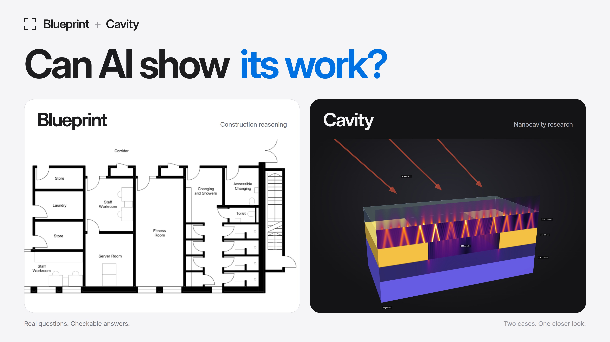

# Blueprint + Cavity

**Real questions. Checkable AI answers.**

[](https://github.com/Yue-fy/blueprint-cavity/actions/workflows/verify.yml)
[中文说明](README.zh-CN.md) · [Live demo](https://blueprint-takeoff-lab.bronze-crane-2444.chatgpt.site/) · [Watch the 84-second film](https://blueprint-takeoff-lab.bronze-crane-2444.chatgpt.site/film/) · [Download release](https://github.com/Yue-fy/blueprint-cavity/releases/tag/v1.0.0)

[](https://blueprint-takeoff-lab.bronze-crane-2444.chatgpt.site/)

Two parallel cases make an AI answer inspectable: follow a decision on a real construction drawing, or examine a numerical claim against a nanoscale light cavity's saved scientific data. This repository includes the runnable product, task packages, scoring code, recorded evidence and submission materials.

| Case | What you can do | Evidence you can inspect |
| --- | --- | --- |
| **[Blueprint](https://blueprint-takeoff-lab.bronze-crane-2444.chatgpt.site/#tour/1)** | Follow saved AI tool calls, select drawing evidence, submit a measurement and compare rewards | 36 construction tasks; 144 historical trials, including 72 model replays |
| **[Cavity](https://blueprint-takeoff-lab.bronze-crane-2444.chatgpt.site/#cavity)** | Explore hBN fields and modes, change the linewidth window and check a pasted numerical reply | Precomputed RCWA/COMSOL visualizations and spectra; a browser-local checker |

## Start with the product

The **[public demo](https://blueprint-takeoff-lab.bronze-crane-2444.chatgpt.site/)** requires no login or password. Both cases have equal entry points.

- **2–4 minutes:** follow the Blueprint room-area story, then open Cavity's linewidth-window experiment.
- **10 minutes:** use the [judge's review guide](docs/REVIEW_GUIDE.md) to inspect a replay, submit a human answer, explore Cavity and check the evidence boundaries.
- **Full detail:** [44-page Chinese product manual](docs/PRODUCT_MANUAL.zh-CN.pdf) and [10-page Chinese walkthrough](docs/JUDGE_WALKTHROUGH.zh-CN.pdf).
- **Submission:** [Copy-ready form fields](submission/form-fields.en.txt) and an [English presentation PDF](docs/presentation/Blueprint-Cavity-Presentation.pdf).

The film, covers, English subtitles, upload copy and manuals are available in [Release v1.0.0](https://github.com/Yue-fy/blueprint-cavity/releases/tag/v1.0.0) and the [public download hub](https://blueprint-takeoff-lab.bronze-crane-2444.chatgpt.site/submit/). The prepared film has not yet been uploaded to YouTube.

## Run locally

Use Python **3.12**. A standard-library audit works before installing any dependencies:

```bash
git clone https://github.com/Yue-fy/blueprint-cavity.git
cd blueprint-cavity
python3 scripts/judge_check.py
```

Expected first line:

```text
PASS: 40 tasks × 6 offline controls; reference 1, noop 0, stop-early 0.10.
```

To run the complete local website with [uv](https://docs.astral.sh/uv/):

```bash
uv venv --python 3.12 .venv
uv pip install --python .venv/bin/python -r requirements-demo.txt
bash scripts/serve.sh
```

Open **http://127.0.0.1:8430/**. To choose another port, run `PORT=8434 bash scripts/serve.sh`. The drawing workspace, Cavity exhibit, film, PDFs and submission downloads are bundled. No model key or cloud account is needed; installing dependencies is the only network requirement for this local-demo path. Use Ctrl+C to stop the server.

Alternatively, with Python's `venv`/`ensurepip` support installed:

```bash
python3 -m venv .venv
.venv/bin/python -m pip install -r requirements-demo.txt
bash scripts/serve.sh
```

The shell launcher targets Linux/macOS. On Windows, create a Python environment, install the same requirements, and run `python -m uvicorn blueprint_gym.server:app --host 127.0.0.1 --port 8430` from the repository root.

## What Blueprint evaluates

An agent receives a licensed drawing and a work order. It can render a PDF, use OCR, inspect geometry and calculate quantities, then submit a value, unit, confidence, evidence rectangles and assumptions. The five families cover floor area, skirting, openings, slab area and piping/equipment counts. Twelve scenarios each appear as vector PDF, clean image and explicitly synthetic scan.

The offline verifier combines **75% value, 15% evidence and 10% confidence calibration**. Evidence credit is gated by the numerical answer. A no-op earns zero; valid abstention can earn at most 0.1.

| Historical run group | Trials | Mean reward |
| --- | ---: | ---: |
| Kimi | 36 | 0.807308 |
| DeepSeek | 36 | 0.392409 |
| Privileged gold-reference oracle | 36 | 1.000000 |
| No-op | 36 | 0.000000 |

For the fitness room, DeepSeek submits **29.1 m²**, Kimi **26.4 m²**, and the reference is **26.9 m²**. The saved trajectory exposes the boundary choice behind the difference. Inspect [that reference](tasks/bp-01-clean/tests/gold.json), [DeepSeek's replay](data/trajectories/full-deepseek-bp-01-clean.json), [Kimi's replay](data/trajectories/full-kimi-bp-01-clean.json), and the [complete result report](RESULTS.md).

These numbers are **rewards, not accuracy percentages**. The 144 trials include 72 actual model attempts, not 144 model attempts. Each model/task pair has one recorded formal attempt; three independent repeats and model-weight training have not been performed. The oracle is a privileged scoring ceiling. Shared source drawings and synthetic scans do not establish generalization to unseen buildings.

## What Cavity shows

hBN is a layered crystal in which infrared light couples to lattice vibrations. The cavity geometry affects how those coupled waves fit inside the structure. Cavity makes the saved fields, modes and spectra visible before asking whether a numerical interpretation is supported.

On the same saved spectrum, a full window produces a Q estimate of **52.7**, while a narrower window produces **96.4**. The interaction shows sensitivity to analysis choices. A companion local reply checker compares a supported numeric answer pasted from an AI response with a fixed mathematical reference. It does not call a model, run a new simulation, validate a scientific proof or verify a cavity design.

See the [Cavity source and scope](hbn_demo/README.md). A separate [four-task mathematical toy](science_demo/ENVIRONMENT.md) has its own 16 historical trials. Those trials are not hBN validation and are not included in the construction denominator.

## Verify and reproduce

```bash
python3 scripts/verify_evidence.py
python3 scripts/judge_check.py
uv pip install --python .venv/bin/python -r requirements-test.txt
.venv/bin/python -m pytest tests -q
```

The first command verifies the hashes of 604 frozen evidence files. The second checks 240 deterministic scoring fixtures and the recorded ledgers; it does not run an AI model. CI performs these checks and the test suite without model-provider credentials.

To prepare a **new** evaluation protocol without executing it:

```bash
python3 scripts/judge_protocol.py --suite core --model kimi --environment docker --run-id review-core
```

This prepares fresh task copies and reference / three model attempts / no-op / stop-early configurations. Execution is a separate explicit `--execute` action requiring the pinned Harbor environment, provider credentials and an appropriate container runtime. The generated Verda-only network policy has not been verified in a live Docker/Modal run. Public answers and replays are available in this repository; this release is not an uncontaminated hidden test set. See [evaluation guidance](docs/EVALUATION.md).

## Repository map

| Path | Contents |
| --- | --- |
| `blueprint_gym/`, `web/` | Scoring, verifier, API and product UI |
| `tasks/` | 36 Harbor-compatible construction task packages |
| `data/` | Licensed drawings, provenance, catalog, historical results and sanitized replays |
| `hbn_demo/` | Self-contained precomputed Cavity exhibit and inspectable display/checker code |
| `science_demo/` | Separate mathematical toy, tasks and historical results |
| `docs/` | English review guide, Chinese manuals, evidence hashes and development decisions |
| `scripts/`, `tests/`, `configs/` | Offline audit, evaluation preparation, regression checks and historical configs |
| `public_delivery/`, `public_submission/` | Exact files served by the local film, guide and download routes |
| `submission/` | Upload-ready text, credits and presentation manifest |

## Sources and licensing

Original project code and documentation use the [MIT license](LICENSE). Drawing assets, music, the scientific background figure and research visualizations retain their respective terms; see [LICENSES.md](LICENSES.md) and [full media credits](submission/CREDITS.txt).

The film uses **“Catalyst” by Scott Buckley**, CC BY 4.0, and a credited crop of Figure 1a from Barra-Burillo et al., *Nature Communications* 12, 6206 (2021). That figure explains a background concept using a different device geometry. It is not this project's measurement. The prepared YouTube description contains the required attributions.
