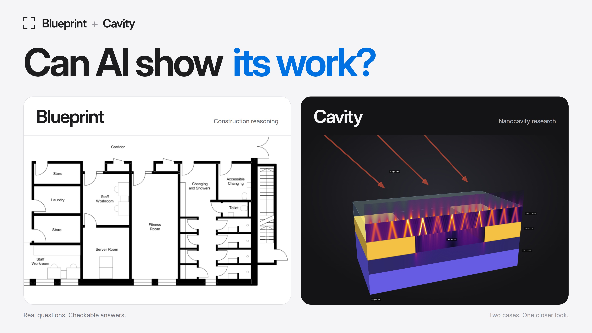

# Blueprint + Cavity

**两个并列案例，检查 AI 答案背后的决策、数据与证据。**



[公开网站](https://blueprint-takeoff-lab.bronze-crane-2444.chatgpt.site/) · [84 秒影片](https://blueprint-takeoff-lab.bronze-crane-2444.chatgpt.site/film/) · [影片与提交包下载 · v1.0.0](https://github.com/Yue-fy/blueprint-cavity/releases/tag/v1.0.0) · [English](README.md)

这个仓库是供评审与本地复现使用的整理版。网页首页给 **Blueprint** 和 **Cavity** 同等入口；可以任选一个开始，再用顶部导航切换。两者都强调可检查的依据，但拥有不同的实验记录。

| 案例 | 你可以做什么 | 当前证据 |
| --- | --- | --- |
| **Blueprint · 建筑计量** | 看 AI 如何从真实图纸选边界、计算数量和留下证据；回放保存的工具调用；亲自框选并交给同一个评分器 | 36 题、144 个历史 trials，其中 72 个是真实模型运行与回放 |
| **Cavity · 纳米光学** | 探索 hBN 纳米腔的保存场图与模式，改变线宽分析窗口，检查粘贴回复中的数值 | 预计算科研数据与浏览器本地检查器；没有 hBN 模型评估矩阵或在线科学 agent |

## 先体验，再检查

**2–4 分钟：** 打开 [Blueprint 四步案例](https://blueprint-takeoff-lab.bronze-crane-2444.chatgpt.site/#tour/1)，看同一健身房的 29.1 m²、26.4 m² 与 26.9 m² 参考如何对应到保存的边界决策和奖励；再打开 [Cavity 入门](https://blueprint-takeoff-lab.bronze-crane-2444.chatgpt.site/#cavity)，进入线宽窗口实验与本地回复检查。

**10 分钟：** 按 [英文评审路线](docs/REVIEW_GUIDE.md) 操作两案、提交一个人工答案、查看历史分母，并运行离线审计。中文详细版本见 [评审指南 PDF](docs/JUDGE_WALKTHROUGH.zh-CN.pdf)。

- [公开网站](https://blueprint-takeoff-lab.bronze-crane-2444.chatgpt.site/)：无需登录，包含案例、工作台、结果与完整 Cavity 页面。
- [Release v1.0.0 下载](https://github.com/Yue-fy/blueprint-cavity/releases/tag/v1.0.0)：84 秒英文字幕影片与提交包，使用页面中的 **Assets** 下载。
- [中文产品手册 PDF](docs/PRODUCT_MANUAL.zh-CN.pdf)：30 章详细介绍功能、交互、技术工具、评分、科研边界与开发过程。
- [中文产品手册 Markdown](docs/PRODUCT_MANUAL.zh-CN.md)：便于仓库内阅读和搜索。历史实现过程中的路径可能属于原工作仓库；当前运行与评审入口以本 README 和英文评审路线为准。
- [提交表单英文文案](submission/form-fields.en.txt)：按字段复制；[英文路演 PDF](docs/presentation/Blueprint-Cavity-Presentation.pdf) 可直接上传到 Presentation 栏。
- [技术奖项参与说明](TECH_CHALLENGES.md)：建议勾选 Verda、Modal、Codex，包含实际使用过程、公开证据、英文提交段落和中文填写说明。

## 本地复现

使用 **Python 3.12**，在仓库根目录执行。离线审计只依赖 Python 标准库，不调用模型，也不需要密钥：

```bash
python3 scripts/judge_check.py
```

它检查 36 道建筑题和 4 道独立数学题，每题 6 类控制输入，共 **240 个确定性 fixtures**，并核对历史结果的完整任务分母。预期首行是：

```text
PASS: 40 tasks × 6 offline controls; reference 1, noop 0, stop-early 0.10.
```

启动网页工作台（推荐使用 uv）：

```bash
uv venv --python 3.12 .venv
uv pip install --python .venv/bin/python -r requirements-demo.txt
bash scripts/serve.sh
```

或者使用已安装 venv/ensurepip 支持的 Python：

```bash
python3 -m venv .venv
.venv/bin/python -m pip install -r requirements-demo.txt
bash scripts/serve.sh
```

打开 **http://127.0.0.1:8430/**。这条路线展示现有数据、运行本地评分，不会启动新的 Harbor 模型试验。首次安装依赖需要联网；浏览器请通过此服务器访问，不要双击网页文件来替代 API 服务。终端使用 Ctrl+C 停止。

## 建筑结果应该怎样读

36 题来自 12 个场景的三种呈现条件：矢量 PDF、清晰图片、明确标注为合成的扫描图片；五类任务覆盖房间面积、踢脚线、门窗集合、楼板面积和管线/设备。模型可读取输入、渲染图纸、运行 OCR、计算几何，最后提交数量、单位、置信度、证据框与假设。

| 历史运行组 | trials | 平均奖励 |
| --- | ---: | ---: |
| Kimi | 36 | 0.807308 |
| DeepSeek | 36 | 0.392409 |
| Oracle：有特权的 gold reference | 36 | 1.000000 |
| No-op | 36 | 0.000000 |

奖励由数量 75%、证据 15%、置信校准 10% 组成；证据得分受数值正确程度约束。**奖励不是准确率**。144 个 trials 中只有 72 个是模型运行；Oracle 的 1.0 检查参考上限，不代表同输入条件下训练出的完美策略。每个模型/任务组合只保存一次正式尝试，**尚未完成三次独立重跑，也没有训练模型权重**。离线 240 个 fixtures 不是新增模型试验。

[建筑历史结果](data/results.json)与[评分实现](blueprint_gym/scoring.py)可直接核对。独立数学玩具另有 **4 题 / 16 个 trials**，其中 8 个是模型尝试；见[独立结果](science_demo/results.json)。它既不计入建筑 144 条，也不是 Cavity 物理验证。

## Cavity 应该怎样读

[Cavity Lab](https://blueprint-takeoff-lab.bronze-crane-2444.chatgpt.site/hbn/) 展示保存的 hBN 纳米腔数据。旋转画面、切换模式或改变分析窗口不会启动新模拟。线宽实验让人观察同一谱线在不同窗口下得到不同 Q 估计；较高 Q 不自动代表更准确。

“AI reviews AI”允许复制题目、在自己的 AI 中获取回复后粘贴检查。浏览器以固定数学题的参考值核对支持格式中的数值，或识别需要人工复核的判断，**不调用模型 API，不给证明正确性打分，也不验证器件设计**。评审可以直接输入测试文本，无需进行新推理。科研收敛限制和数据范围在页面与详细手册中列明。

## 从哪里核对

| 内容 | 入口 |
| --- | --- |
| 具体示范任务 | [tasks/bp-01-clean](tasks/bp-01-clean/) |
| DeepSeek / Kimi 原始保存轨迹 | [DeepSeek](data/trajectories/full-deepseek-bp-01-clean.json) · [Kimi](data/trajectories/full-kimi-bp-01-clean.json) |
| 人类界面与交互 | [web](web/) |
| 确定性计分与离线审计 | [scoring.py](blueprint_gym/scoring.py) · [judge_check.py](scripts/judge_check.py) |
| 独立数学玩具 | [science_demo](science_demo/) |
| Cavity 预计算展示 | [hbn_demo/index.html](hbn_demo/index.html) |
| 更详细的使用与证据路线 | [REVIEW_GUIDE.md](docs/REVIEW_GUIDE.md) · [中文评审 PDF](docs/JUDGE_WALKTHROUGH.zh-CN.pdf) |

公开仓库和网站包含参考答案及回放，不能作为未泄露的隐藏测试集。若开展新的评测，必须另行核查任务、网络隔离与独立运行记录；历史配置不构成防止公开答案污染的保证。

源代码与图纸、科研数据、论文图片、音乐等素材具有各自的许可范围，见 [LICENSE](LICENSE) 和 [LICENSES.md](LICENSES.md)。影片使用 Scott Buckley 的 **Catalyst**（CC BY 4.0）；Release 提交包保留完整署名。公开展示科研数据的授权不等于给所有研究材料重新授予开源许可证。
